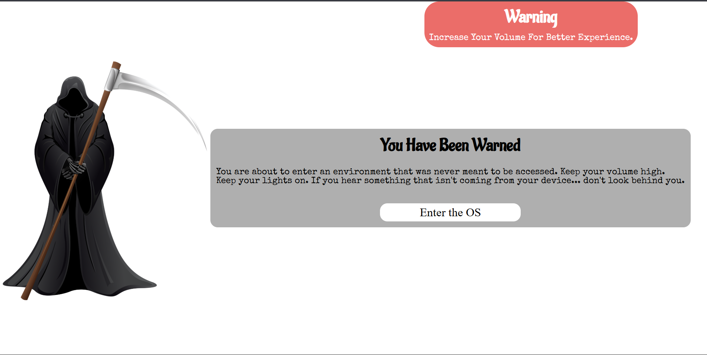
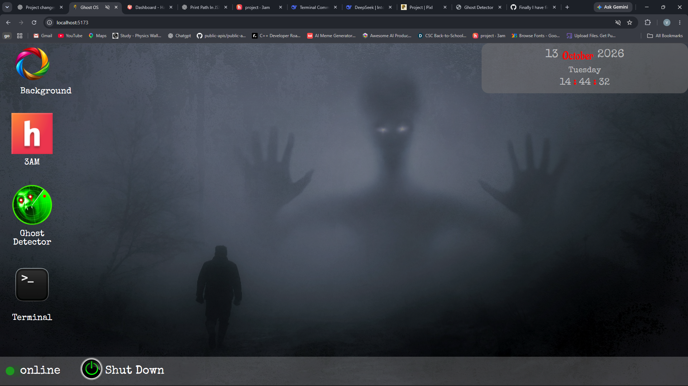
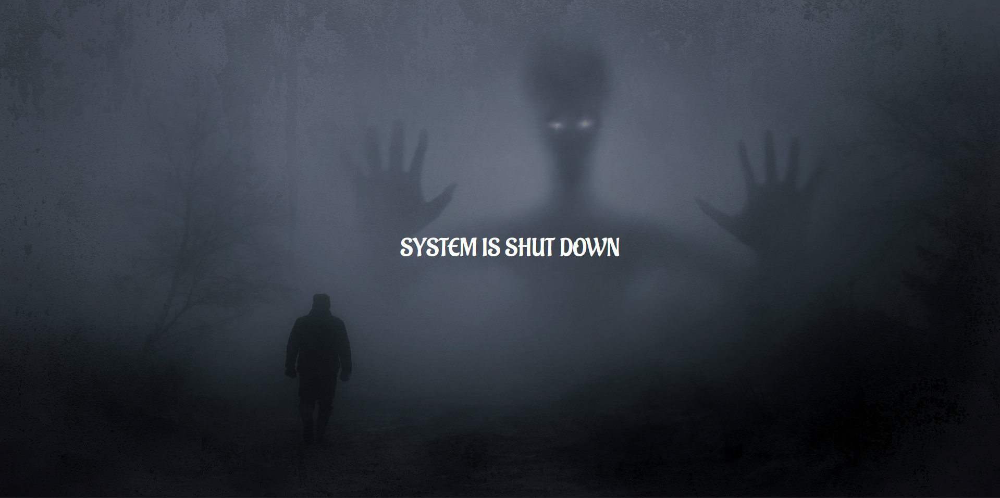

# Ghost OS

## Screenshot

## About

Ghost OS is a dark themed + spooky webOS. It start from a warning at the first page. If you still dare to enter the OS, then the creepy sound effect is enough to make you scare and make you press the shutdown button. You can change the background. Don't forget to drag it, as I have spend most of my time making it draggable, so kindly drag it. Otherwise the ghost will get angry and he can punish you.

## Features

It contains three apps. First app is background app, it is to change the background. It is draggable also, to drag it just left on the click on the header and drag it while holding the left click. So simple. Second app is a redirect link to 3AM, it is the most horror and spooky part as it redirects you to the hub of such spooky and horror projects. Third app is a ghost detector, this app is built by me and submitted to 3AM, it basically detects whether any ghost is present near you or not. Therefore, it is mandatory to use it because I had put a lots of efforts in building it. And if you do not try then my ghost friends will also stay with you.

## Challenges

To be honest, everything was easy excepting the draggable window, it was really super hard. 